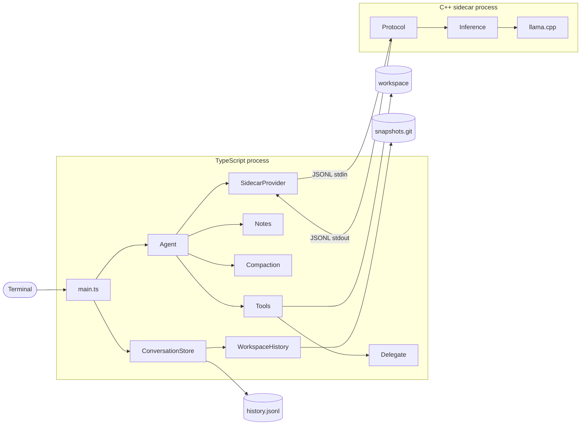
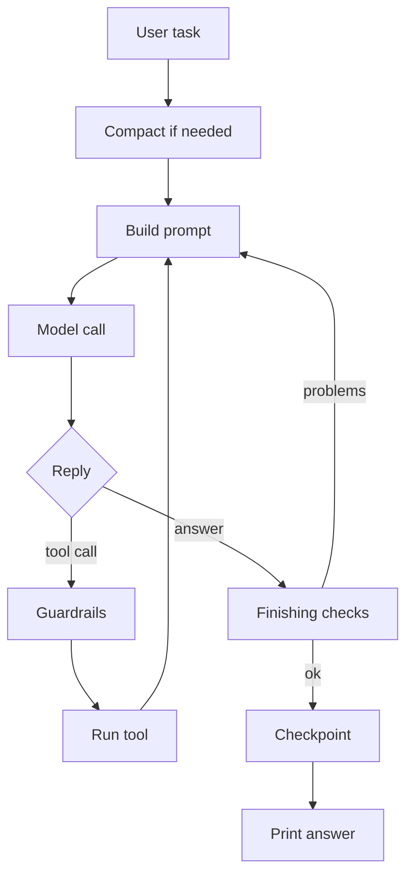
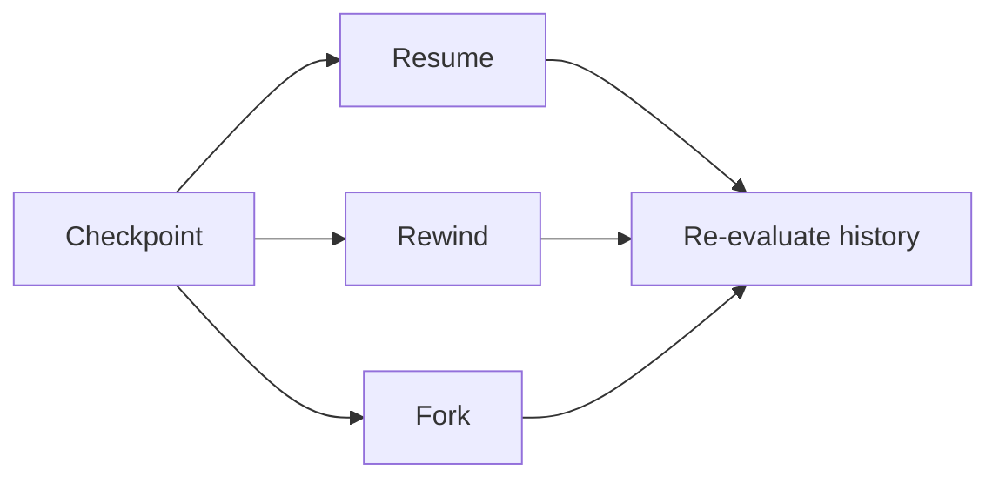

# System design

How the harness fits together, one line per piece. For step-by-step flows,
exact limits and failure handling, see
[notes/SYSTEM_FLOWS.md](notes/SYSTEM_FLOWS.md).

## System

- **Terminal:** where you type tasks and slash commands.
- **main.ts:** opens or resumes a conversation, routes slash commands and saves a checkpoint after each task.
- **Agent** (`ts/agent.ts`): runs one task by calling the model, running its tool calls and looping until it answers or hits a limit.
- **Tools** (`ts/src/tools/`): read, create, edit and delete files, search, and run commands or background programs inside the workspace.
- **Notes** (`ts/src/notes.ts`): keeps the objective, changed files, last error and the model's plan pinned to the end of every prompt.
- **Compaction** (`ts/src/compaction.ts`): swaps older messages for a model-written summary when the prompt nears the 16K context, without deleting them.
- **Delegate** (`ts/src/subagents.ts`): runs a Reader or Writer child agent on the same loaded model and returns its compact JSON report.
- **SidecarProvider** (`ts/src/providers/`): renders messages into Qwen's chat format, sends them to the sidecar and parses the reply into an answer or tool call.
- **ConversationStore** (`ts/src/conversationStore.ts`): appends messages and checkpoints to a digest-checked log and handles resume, rewind and fork.
- **WorkspaceHistory** (`ts/src/workspaceHistory.ts`): captures and restores the workspace's files as Git trees.
- **Protocol** (`main.cpp`, `protocol.cpp`): reads one JSON request per line, validates it and writes one JSON reply.
- **Inference** (`model.cpp`): tokenizes the prompt, reuses the cached prefix, evaluates the rest and samples, using a grammar once a tool call starts.
- **llama.cpp:** the pinned inference library that runs the Qwen2.5-Coder-7B GGUF on the GPU.
- **workspace:** the conversation's private copy of the launch folder, where all tool calls happen.
- **history.jsonl:** the durable record of messages, compactions, checkpoints and rewinds.
- **snapshots.git:** a bare Git store holding every checkpoint's files, shared by all conversations.

## One task

## Conversation history

