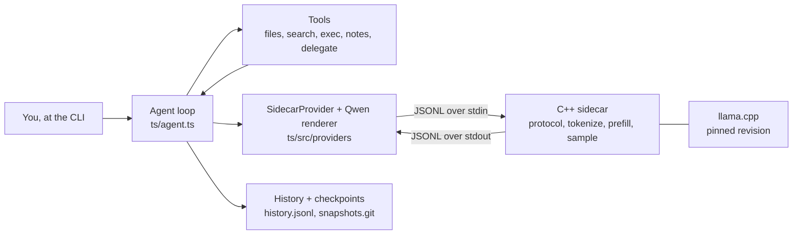

# Local coding-agent harness

A coding agent that runs entirely on a laptop. A TypeScript agent loop drives
Qwen2.5-Coder-7B-Instruct model, through a C++ sidecar connected to llama.cpp. 

The harness saves every conversation, pairs checkpoints of the agent's workspace
with its messages, and can rewind or fork a conversation to any checkpoint. It's being iterated and evaluated, through a number of eval tests. Plan to test on SWE-bench eventually. 

## Architecture



- **Agent loop (TypeScript):** Renders the conversation, calls the model,
  parses tool calls, runs tools and loops. It also catches repeated calls,
  checks edits before applying them, and compacts older messages when the
  prompt nears the 16K context.
- **Sidecar (C++):** A long-lived process that loads the model once and answers
  versioned JSONL requests. It reuses a evaluated prefix in RAM and evaluates tool outputs one at a time. 
- **Tools:** Read, create, edit and delete files, search, run commands and
  manage background programs; keep pinned notes; and delegate to Reader/Writer
  subagents that share the loaded model. Handled thru TypeScript.

## What is saved

The harness persists history, not KV-cache state, trading off speed for less memory consumption. 

| State | Durable storage |
| --- | --- |
| Messages, tool calls and results, compaction summaries, configuration | `sessions/<id>/history.jsonl` Contains all the relevant history of the conversation|
| Workspace file versions paired with checkpoints | Local `snapshots.git` object store. Used for rewinding/forking |
| Full search and command output | `.harness/outputs` in the workspace. Relevant for logging.|
| Evaluated tokens and KV state | RAM only, freed up upon shuttering down the model |

Resume, rewind and fork restore the messages and settings, and re-evaluate
the rendered history. Background preparation can do this while you read or
type, but can take some time. 

## Features

- Saved conversations with `/checkpoints`, `/show`, `/rewind`, `/fork`,
  `/switch` and `/delete`
- A separate workspace per conversation, so forks get independent files
- Context compaction, while keeping the full history on disk
- Pinned notes (objective, changed files, last error, model-maintained plan). Relevant for keeping these smaller models on track, continue working towards objective.
- Background programs with `/ps`, `/attach`, `/detach` and `/stop`
- Sequential Reader/Writer subagents that return a compact report

## Start


Start a conversation, or resume one, with:

```sh
./harness.sh
./harness.sh --resume <conversation-id>
```

`harness.sh` works in `~/harness-play` and starts the sidecar itself. Set
`HARNESS_FOLDER`, `SIDECAR_EXECUTABLE` or `LLAMA_MODEL_PATH` to override the
defaults (the model defaults to
`~/models/qwen2.5-coder-7b/Qwen2.5-Coder-7B-Instruct-Q4_K_M.gguf`).


