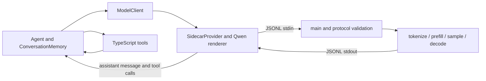

# Sidecar flow and configuration

Read this alongside the source. Every model generation in the current CLI uses
SidecarProvider, the C++ harness-sidecar process, and the llama.cpp library
linked into that process. There is no current HTTP or llama-server provider
route. The path is non-streaming inference with one retained context and a
fresh sampler per request. The expected model is Qwen3-4B-Instruct-2507 Q4_K_M;
the runtime loads the GGUF named by LLAMA_MODEL_PATH. llama.cpp is pinned to
revision 7fe450e19305b828c199d602c23a8337aaa1f03b.

Durable history is managed by TypeScript: saved messages/configuration plus Git
workspace snapshots. Reopening or restoring a conversation rebuilds inference
from its rendered history. The sidecar does not save/load KV snapshots or write
a separate token-ID log; its KV state and prefix reuse exist only in RAM.

## Follow one model call

1. `ts/agent.ts` adds the user message to ConversationMemory. ModelClient sends the
   complete message history, generation settings, and tool definitions to the provider.
2. `ts/src/providers/sidecar.ts` starts the executable once with the GGUF path.
   C++ loads that model before reading requests; the correlated ping checks the
   protocol response. TypeScript renders the complete prompt through `qwen.ts`,
   then writes one JSONL generate request to stdin.
3. `c/src/main.cpp` reads a bounded record. `protocol.cpp` validates the envelope
   and settings, calls generate, and turns request failures into correlated errors.
4. `c/src/model.cpp` tokenizes, checks capacity, retains the matching evaluated prefix,
   evaluates the remaining prompt, and samples until EOG or the output limit. It returns
   text, completion reason, and counts. main flushes one JSON response to stdout.
5. SidecarProvider assembles arbitrary stdout chunks, checks the response ID, and maps
   the result into ModelResponse. For EOG it parses Qwen tool-call blocks into assistant
   toolCalls and assigns each a random ID in TypeScript. The ID is then kept with the
   matching tool result. Agent checks the tool name and JSON-object shape; each tool
   performs its own input checks. The Agent stores results and sends the updated history
   through the same sidecar on its next model call.

### How the response gets back to the Agent

`send()` creates a Promise, saves its resolve/reject callbacks and request ID in
`pending`, and writes the JSONL request to the sidecar's stdin. The stdout
listener, attached once in `start()`, buffers chunks until it has a complete
newline-delimited response. It parses the response, checks its ID, clears the
timeout and pending slot, then resolves the Promise with the result. For a
valid sidecar error, it rejects the Promise; a malformed or mismatched response
fails the provider.

`generate()` awaits that Promise. After a successful result arrives, it validates
and converts it to a `ModelResponse`, which returns through `ModelClient` to the
Agent. The Agent stores the response and either runs requested tools and loops
back for another model call, or returns the final result.



C++ receives rendered text, not message objects or executable tools. ConversationMemory
owns conversation history. C++ owns only inference state.

## Wire contract

A generate record uses the existing versioned envelope:

```json
{"v":1,"id":"r2","method":"generate","params":{"prompt":"rendered text","max_tokens":2048,"temperature":0.2,"seed":42}}
```

The success result contains text, completion_reason (eog or length), prompt_tokens,
reused_tokens, prefilled_tokens, generated_tokens, and evaluated_tokens.
Errors contain code and message with ok=false.
protocol.cpp accepts a nonempty prompt, positive 32-bit max_tokens, optional temperature
from 0 to 2, optional seed from 0 to 4294967294, and optional sequence 0 or 1
(default 0). Unknown settings are rejected. The parent conversation uses sequence 0;
a Reader/Writer child uses sequence 1. A release record frees one sequence's cache:

```json
{"v":1,"id":"r9","method":"release","params":{"sequence":1}}
```

Its result contains released_tokens.

## Startup and ownership

main initializes the backend, loads one model, and creates one Inference owner.
Inference retains its context and one evaluated token list per sequence across
requests. Each request creates a fresh sampler. Shutdown destroys Inference before
the model and backend. Any exception from generation clears that sequence's cache
and evaluated token list; the other sequence is kept.

The provider allows one pending request. A valid C++ error rejects that request while
leaving the process usable. Protocol validation errors occur before inference and
do not change the cache; exceptions inside generate clear it.
Broken JSON, a wrong ID/version, unexpected EOF/exit,
pipe failure, or a five-minute request timeout invalidates the provider and terminates
its child. It does not restart or retry. main.ts uses finally to call shutdown:
close stdin, wait for process exit, and force termination after five seconds if needed.

## Tokenization, positions, and output

The renderer supplies ChatML markers and the final assistant header. Tokenization uses
add_special=false and parse_special=true: no automatic BOS is added, while template
markers become special token IDs. The current GGUF also specifies add_bos_token=false.

Prompt tokens occupy positions 0 through P-1. Prefill uses batches up to the actual
llama_n_batch limit; llama.cpp handles the smaller microbatches internally. The batch's
positions array supplies absolute positions. Its logits flags request next-token logits
only for the final prompt token. Sampling reads that output using index -1.

A sampled token increments generated_tokens. An EOG token stops generation without text
or decoding. Other tokens append their byte pieces; unless the output limit is reached,
they are evaluated at the next position so the next sample has fresh logits. These
decode calls request logits at their single position.

The capacity rule is P + max_tokens - 1 <= actual context capacity. The last sampled
token is never evaluated, so it needs no additional KV slot. For the current successful
loop, evaluated_tokens = prefilled_tokens + generated_tokens - 1. generated_tokens includes
a terminal EOG token; text does not. Counts are accumulated from sampling/decode work,
not calculated from characters. prompt_tokens = reused_tokens + prefilled_tokens.
evaluated_tokens counts work performed during this request, excluding reused tokens.
Both sequences share the 16,384 cells. If a request's P + max_tokens - 1 would not
fit beside the other sequence's cached tokens, the other sequence's cache is dropped
first and rebuilt from its prompt the next time that sequence is used.

The caller sends the complete prompt. Inference compares its token IDs with that
sequence's evaluated tokens, removes the cached suffix, and prefills the remainder.
Failed suffix removal falls back to clearing that sequence and zero reuse. For a
fully cached prompt of P tokens, remove cached state from position P-1 onward and
re-evaluate the final prompt token with logits requested. Report P-1 reused tokens
and one newly evaluated prompt token, including when a generated suffix was removed.

Token pieces may split UTF-8 characters. C++ accumulates bytes before JSON serialization.
Invalid UTF-8 bytes in the response text are replaced with U+FFFD during JSON
serialization. Node's UTF-8 stream decoder also handles pipe chunks split inside
a character.

## Settings to change

| Setting | Current value | Where to edit |
| --- | --- | --- |
| Model file | LLAMA_MODEL_PATH | Environment; passed as the sidecar argument |
| Executable | c/build/harness-sidecar from repository root | SIDECAR_EXECUTABLE can override it |
| Model GPU layers | 99 requested | model_params.n_gpu_layers in c/src/main.cpp |
| Context capacity | 16384 requested, shared by sequences 0 and 1 | context_params.n_ctx, n_seq_max and kv_unified in c/src/model.cpp |
| Batch / microbatch | llama.cpp defaults; actual values logged | context_params before llama_init_from_model |
| Temperature | 0.2 in the harness | model.temperature in ts/main.ts; 0 selects greedy |
| Output limit | 2048 in the harness | model.maxTokens in ts/main.ts |
| Seed | Random when omitted | optional model.seed; 0..4294967294; ignored by greedy |
| Request timeout | 300000 ms | SidecarProvider constructor default |
| Model-family formatting | Qwen GGUF chat/tool template | ts/src/providers/qwen.ts |
| Dependency revision | 7fe450e19305b828c199d602c23a8337aaa1f03b | c/CMakeLists.txt |

ModelClient forwards generation settings to the sidecar. The GGUF loaded at
startup selects the actual model; requests have no separate model identifier.

Sampling is greedy at temperature 0, otherwise temperature followed by seeded
distribution sampling. There are no top-k, top-p, repetition penalties, or tool grammars.
Changing to another model family requires reviewing tokenization, the renderer, and
the output parser as well as changing the GGUF path.

## Prompt and tool formatting

qwen.ts manually builds Qwen-style prompt text in TypeScript, including the tool
preamble and assistant reasoning-history handling. It does not load the template
from the GGUF at runtime; exact prompt and token parity with the local GGUF has
not been established. The tool preamble contains names, descriptions, and parameter
schemas; execute functions never cross stdin. Valid stored tool arguments may be
parsed and reserialized with template-style spacing. Invalid argument strings are
retained so Agent/tool handling can return an error result.

Consecutive tool results share one user turn containing separate tool_response blocks.
Qwen's template does not print tool-call IDs; TypeScript still preserves those IDs
on assistant calls and their matching tool-result messages.

The parser accepts one or more tool_call blocks and handles a closing tag inside a JSON
string. Malformed generated blocks raise a provider error. Agent checks the tool name
and that arguments parse to a JSON object; the advertised JSON schema is not centrally
enforced, and individual tools validate their own inputs. A length result bypasses
parsing and executes no partial tool calls.

## Run from the repository root

Use CMake 3.24 or newer and Node 22 or newer. Install TypeScript dependencies
once if they are not already present. The first CMake configure fetches the pinned
dependencies.

```sh
npm ci --prefix ts/src/dependencies
cmake -S c -B c/build
cmake --build c/build --target harness-sidecar --parallel
export LLAMA_MODEL_PATH="/absolute/path/to/Qwen_Qwen3-4B-Instruct-2507-Q4_K_M.gguf"
node ts/src/dependencies/node_modules/tsx/dist/cli.mjs --tsconfig ts/tsconfig.json ts/main.ts 2>sidecar.log
```

LLAMA_MODEL_PATH must name an existing GGUF and be exported or supplied on the
same command. If the runner exits immediately, read sidecar.log: stderr includes
missing-setting and startup errors. main does not load a .env file.

main.ts accepts sequential tasks using one Agent and retained conversation.
Type c and press Enter at the prompt to exit. This does not interrupt a running task.
Exiting releases live conversation objects and inference state. Completed turns
remain saved and can be resumed; their inference context is recomputed.
Unfinished turns are not guaranteed saved.

## Choose the workspace directory

The launch directory selects the session store and files eligible for seeding.
New coding conversations run tools in their own `sessions/<id>/workspace`, not
in the launch directory. Legacy v1 conversations retain their startup root.
After exporting LLAMA_MODEL_PATH above, launch from another project folder with:

```sh
HARNESS=/Users/rohilverma/Desktop/harness
cd /path/to/project
SIDECAR_EXECUTABLE="$HARNESS/c/build/harness-sidecar" \
node "$HARNESS/ts/src/dependencies/node_modules/tsx/dist/cli.mjs" \
  --tsconfig "$HARNESS/ts/tsconfig.json" "$HARNESS/ts/main.ts" 2>sidecar.log
```

Tool paths are relative to the printed active workspace: use AGENT_TEST.md, not
sessions/<id>/workspace/AGENT_TEST.md. The executable override is needed because the
default sidecar path is relative to the launch directory. File tools reject
resolved paths outside the active workspace. run_command validates paths and
working directories, but project scripts can access other locations; it does not provide OS filesystem isolation.

## Debug by stage

stderr includes both upstream llama.cpp diagnostics and our prefixed messages.
stdout on the child pipe contains JSONL responses only. Harness console/tool output
belongs to the parent and is separate.

| Log | Meaning |
| --- | --- |
| loading / model loaded / ready | Startup path, GPU request, load time, model readiness |
| sidecar-provider send | Request ID, method, serialized byte count |
| generate | Request ID, max_tokens, temperature, seed; 4294967295 means random |
| context / prefill | Actual capacity, batching, prompt count, prefill time |
| prefix | Previously cached tokens, reused tokens, new prefill count, or removal-failure reset |
| generation / result | Generation time, completion reason, sampled/evaluated counts |
| generation failed | Cached state is being cleared before the error is returned |
| response / fatal / stdin EOF | Correlated result/error, process failure, shutdown |

A capacity error calls for a shorter rendered history or smaller maxTokens, or an
intentional context-size increase. A failed prefill/decode reports its token position.
A transport error includes the recent stderr tail. Prompts and generated text are not
printed by these logs; existing Agent tool logs can still contain tool inputs/results.

## Check prefix reuse manually

Use two sequential tasks in the same running CLI, replacing these filenames with
files in your workspace:

1. Read file1.md and file2.md and explain how they relate. Do not edit or run commands.
2. Using what you read, explain why file2 depends on file1. Do not edit or run commands.

From a second terminal in that workspace, inspect the diagnostics:

```sh
rg '^\[sidecar\] prefix ' sidecar.log
```

The first generation starts with zero reuse. Later calls compare the full prompt
against evaluated token IDs. In one observed notes session:

```text
[sidecar] prefix cached=0 reused=0 prefill=1369
[sidecar] prefix cached=2868 reused=2868 prefill=39
```

cached is the token history before suffix removal; reused is the portion retained;
prefill is the new prompt work. Reuse can shrink after edits or prompt re-rendering,
so it need not increase on every call. An exact repeated prompt re-evaluates its last
token. Generated tokens count as cached only after they have been decoded.

Positive reuse verifies cached inference work. Conclusion: success means the model
returned a final answer; inspect actual file contents and command results to judge
whether its task succeeded.

## Available checks and validation history

From the repository root:

```sh
node ts/src/dependencies/node_modules/typescript/bin/tsc --project ts/tsconfig.json --noEmit
```

Historical validation before the October 5 provider cleanup included build and
typecheck, transport/parser/Agent checks, a live two-provider workload, greedy
prefix comparisons, and a two-turn CLI check. The two-provider workload describes
the former architecture, not the current runtime. The regression suites and old
C++ exercise were removed at the user's request and cannot be rerun. The October 5
cleanup passed TypeScript typechecking and entrypoint bundling; it did not include
live inference. See notes/decisions.md for later validation and open gaps.

Exact prompt-byte and token parity with the local GGUF remains unverified. If
needed, a separate experiment can compare against a standalone llama-server using
the same GGUF, pinned revision, context, batching, threads, temperature, seed, and
token limits. This is an external reference experiment only; the harness CLI does
not start or route requests through llama-server. The pinned server documents
`/apply-template` and `/tokenize`; sampling and tool-grammar differences must also
be accounted for. Task success is separate from exact output parity.

References: [pinned llama.cpp server documentation](https://github.com/ggml-org/llama.cpp/blob/7fe450e19305b828c199d602c23a8337aaa1f03b/tools/server/README.md)
and [Qwen tokenizer configuration](https://huggingface.co/Qwen/Qwen3-4B-Instruct-2507/blob/main/tokenizer_config.json).
